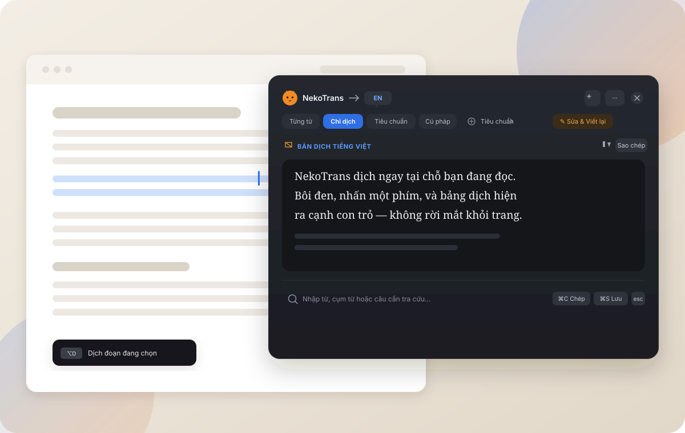

# NekoTrans — landing page

Trang giới thiệu sản phẩm cho **NekoTrans**, viết bằng HTML/CSS thuần.
Không có build step, không phụ thuộc CDN, không dùng font tải ngoài — mở file là chạy.

> Thư mục này không liên quan tới Swift Package. `Package.swift` chỉ trỏ vào
> `Sources/` và `Tests/`, nên thêm/sửa trang này không ảnh hưởng build app.

## Xem thử

```bash
# cách nhanh nhất
open LandingPage/index.html

# hoặc chạy qua local server (giống môi trường thật hơn)
cd LandingPage && python3 -m http.server 8080
# rồi mở http://localhost:8080
```

## Cấu trúc

```
LandingPage/
├── index.html              # toàn bộ nội dung, một trang
├── styles.css              # design tokens + layout + responsive + dark mode
├── assets/
│   ├── favicon.svg         # logo mèo
│   ├── hero-hud.svg        # mock bảng dịch nổi (dùng ở mục 00)
│   ├── notebook.svg        # mock sổ tay từ vựng (mục 02)
│   └── flashcard.svg       # mock thẻ ôn tập (mục 03)
└── README.md
```

Các icon nhỏ trong phần Tính năng nằm trong một **sprite SVG inline** ở đầu
`index.html` (`<symbol id="i-...">`) và được gọi bằng `<use href="#i-...">`.
Thêm icon mới thì thêm một `<symbol>` vào sprite đó.

## Việc cần làm trước khi publish

### 1. Điền các liên kết đang để `href="#"`

Mọi chỗ cần link thật đều được đánh dấu bằng `data-placeholder`, tìm nhanh bằng:

```bash
grep -n 'data-placeholder' LandingPage/index.html
```

| `data-placeholder` | Số chỗ | Cần điền |
|---|---|---|
| `download-url` | 3 | Link tải file `.dmg` / `.zip` |
| `source-url` | 2 | Repo GitHub |
| `changelog-url` | 1 | Trang "Có gì mới" |
| `support-url` | 1 | Kênh hỗ trợ (email, issue, Discord…) |
| `privacy-url` | 1 | Chính sách quyền riêng tư |

### 2. Kiểm chứng lại các con số trong trang

Trang đang nêu những điểm sau, tất cả đều lấy từ code chứ không phải nội dung
marketing tự nghĩ ra — nếu code đổi thì sửa lại cho khớp:

- **6 nhà cung cấp AI trực tiếp** — `DirectAIProvider` trong `AppSettings.swift`.
- **6 phần phân tích AI** — `AIPromptBuilder.structuredWordPrompt(for:)`.
- **Khoảng 14 MB** — kích thước binary release hiện tại.
- **macOS 15.0 trở lên** — vì engine on-device dùng framework `Translation`.
- **Phím tắt mặc định `⌥D` và `⌥S`** — `KeyShortcut.defaultTranslate` / `defaultOCR`.

### 3. Phần giá (chưa có, cố ý)

Trang **không** nêu giá hay mô hình bán, vì tôi không biết bạn chọn gì và không
muốn ghi một điều sai. Khi đã quyết, chèn khối này ngay trước mục `#tai-ve`:

```html
<!-- Thêm ngay trên <section class="cta" id="tai-ve"> -->
<section class="section" id="gia">
  <p class="label">06 <span aria-hidden="true">·</span> Giá</p>
  <h2 class="h2">Một lần mua, dùng tiếp miễn phí</h2>
  <div class="twocol">
    <p class="twocol-lead">
      Trả một lần cho bản đầy đủ. Cập nhật và sửa lỗi miễn phí về sau.
    </p>
    <ul class="ticks">
      <li><strong>Dùng thử 14 ngày.</strong> Không cần thẻ, không cần tài khoản.</li>
      <li><strong>Kích hoạt trên hai máy Mac</strong> của cùng một người.</li>
      <li><strong>Hoàn tiền trong 14 ngày</strong> nếu không hợp.</li>
    </ul>
  </div>
</section>
```

…rồi sửa lại số thứ tự các mục phía sau (mục cuối hiện là `05`).

### 4. Ảnh chụp thật (tuỳ chọn)

Ba hình minh hoạ hiện tại là **SVG tự vẽ**, mô phỏng giao diện thật của app
(đúng bố cục bảng dịch, đúng khung công thức ngữ pháp). Nếu muốn dùng ảnh chụp
màn hình thật thì chỉ cần thay `src` trong `index.html`:

```html

<!-- thành -->

```

Nên xuất ảnh ở bề rộng gấp đôi (2400px cho khung 1200px) để nét trên màn hình
Retina, và giữ `width`/`height` để trang không bị nhảy layout khi tải.

## Ghi chú thiết kế

- **Bảng màu lấy từ chính app**: `AppColors.accent` là xanh dương, `AppColors.phonetic`
  là cam — nên trang dùng xanh `#2F6FE4` làm màu nhấn và cam `#EF7A18` cho chữ 猫
  ở tiêu đề. Nền giấy ấm theo phong cách của ảnh tham chiếu.
- **Typography**: tiêu đề dùng serif hệ thống (`Iowan Old Style` → Palatino → Georgia),
  nội dung dùng sans hệ thống. Không tải font từ mạng nên trang không phụ thuộc dịch vụ ngoài.
- **Dark mode**: theo `prefers-color-scheme`, chỉ đổi token màu. Hai loại nút
  `.btn-dark` / `.btn-light` cố ý **không** dùng token `--ink` vì chúng sẽ đảo màu
  và thành chữ trắng trên nền trắng.
- **Responsive**: 3 breakpoint — 1020px (lưới 3→2 cột, các khối split xếp dọc),
  860px (ẩn menu ngang, mọi lưới về 1 cột, cỡ chữ nhỏ lại).
- **Khả dụng**: có skip-link, mọi ảnh đều có `alt`, `:focus-visible` rõ ràng,
  và tôn trọng `prefers-reduced-motion`.

## Đã kiểm chứng

- Không có anchor gãy, không có `<use>` trỏ sai, không thiếu file cục bộ.
- 3/3 ảnh có `alt`; mọi `var(--…)` trong CSS đều được định nghĩa.
- Đã render thật bằng WebKit ở 1440px (sáng/tối) và 430px để kiểm tra bố cục.
