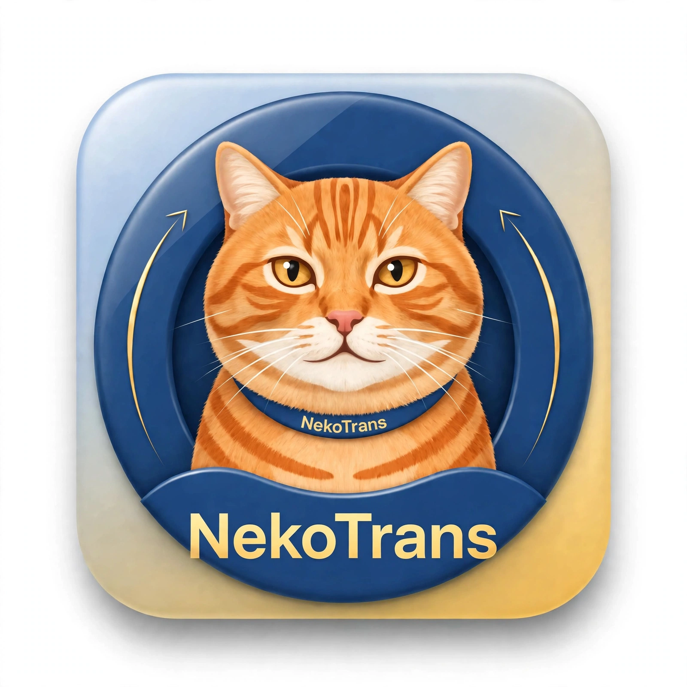

<div align="center">



# NekoTrans

**Trợ lý Dịch thuật AI, Từ điển Thông minh & Sổ tay Từ vựng / Ngữ pháp Native cho macOS**

[](https://www.apple.com/macos/)
[](https://swift.org)
[](#%EF%B8%8F-kiến-trúc-dự-án)
[](#-đa-ngôn-ngữ--phiên-âm)
[](https://opensource.org/licenses/MIT)

</div>

---

## 📖 Giới thiệu

**NekoTrans** là ứng dụng thanh Menu Bar gốc (100% Native `SwiftUI` + `AppKit`) dành riêng cho **macOS 15.0+ (Sequoia)**, giúp bạn tra từ điển chuyên sâu, dịch nhanh đoạn văn theo ngữ cảnh, quét chữ màn hình (OCR), chạy mô hình AI cục bộ (Local GGUF trên Apple Metal) và ôn luyện từ vựng/công thức ngữ pháp bằng thuật toán lặp lại ngắt quãng (**SM-2 Spaced Repetition**).

Ứng dụng được thiết kế tối ưu hiệu năng cao và tiết kiệm bộ nhớ tối đa khi túc trực nền: tự động thu hồi cửa sổ/WebKit khi đóng, nén dữ liệu LZFSE, bảo mật toàn bộ khóa API trong **macOS Keychain**, và hoạt động trực tiếp qua Accessibility API mà không làm bẩn Clipboard của bạn.

---

## ✨ Tính năng nổi bật

### 1. ⚡ Dịch nhanh HUD & Đa động cơ (`⌥ + D`)
- Bôi đen từ hoặc đoạn văn ở bất kỳ ứng dụng nào (PDF, Xcode, trình duyệt, Slack...) và nhấn `Option + D` (hoặc dùng bong bóng chọn từ / nhấn đúp `⌘C`).
- **Đa tầng Engine dịch thuật**:
  - **Apple Translation (Offline)**: Dịch ngoại tuyến tốc độ cao, bảo mật tuyệt đối trên macOS 15+.
  - **Direct Cloud AI**: OpenAI, Anthropic Claude, Google Gemini, Groq, DeepSeek với ngữ cảnh chuyên ngành (*Công nghệ, Kinh doanh, Học thuật, Y khoa, Đời sống*).
  - **In-Process Local GGUF (`llama.cpp` + Metal)**: Chạy trực tiếp mô hình LLM `.gguf` ngay trên chip Apple Silicon không cần internet, tự động giải phóng RAM khi nhàn rỗi.
  - **So sánh song song (Multi-Engine)**: Đối chiếu đồng thời kết quả từ Google Translate, DeepL và AI ngay trong một khung nhìn, kèm kiểm tra ngữ pháp & gợi ý viết lại theo 3 văn phong.

### 2. 🔍 Từ điển học thuật, IPA & Pinyin thông minh
- Tự động chuẩn hóa IPA chuẩn Oxford/Cambridge (`IPANormalizer`), phát âm giọng người thật **UK / US** và giọng **Tiếng Trung (`ZH`)**.
- **Hỗ trợ Tiếng Trung chuyên sâu**: Tự động nhận diện chữ Hán và hiển thị **Pinyin có dấu thanh điệu** dưới cả văn bản gốc, bản dịch, HUD, Sổ tay và Flashcards.
- Tích hợp từ điển hệ thống macOS ngoại tuyến (`DictionaryServices`) và gợi ý từ liên quan ngữ nghĩa bằng vector `NLEmbedding` (`NaturalLanguage`).

### 3. 📸 Quét chữ màn hình OCR (`⌥ + S`)
- Khoanh vùng bất kỳ khu vực nào trên màn hình (video bài giảng, ảnh chụp, slide, trang web khóa bôi đen).
- Nhận diện ký tự tức thì qua **Apple Vision OCR** và hiển thị bản dịch ngay tại chỗ.

### 4. 📚 Sổ tay Từ vựng, Công thức Ngữ pháp & Ôn tập SM-2 (`⌥ + V`)
- **Tách biệt rành mạch Từ vựng & Ngữ pháp**:
  - **Từ vựng**: Lưu nghĩa, phiên âm IPA / Pinyin, từ loại, chủ đề tự động phân loại bằng NLP và ví dụ song ngữ.
  - **Ngữ pháp (`📐`)**: Lưu công thức chuẩn dạng toán học (monospaced), dấu hiệu nhận biết, ví dụ 3 thể (`+`, `-`, `?`), bẫy đề thi TOEIC/IELTS và mẹo ghi nhớ.
- **Flashcards 3D & Spaced Repetition (SM-2)**: Lật thẻ 3D mượt mà với 4 mức đánh giá trí nhớ (**Quên / Khó / Nhớ / Dễ**) tự động tính chu kỳ ngày ôn tập tiếp theo.
- **Xem nhanh (`Spacebar`)**: Nhấn phím cách để mở cửa sổ Quick Look xem chi tiết mục đang chọn.
- **Đồng bộ & Xuất dữ liệu**: Sao lưu đám mây qua **GitHub Gist**, đồng bộ 1 chạm sang **Anki Desktop (`AnkiConnect`)**, tự động ghi nhật ký `words.jsonl` cho Obsidian/Logseq, hoặc xuất ra Markdown / TSV.

### 5. 🤖 Trợ lý AI, Dịch Nổi Khi Bôi Đen & Tích hợp Hệ thống (`⌥ + A`)
- **Dịch Nổi Tức Thì Khi Bôi Đen (Instant Selection Pill)**: 3 chế độ tùy chọn (*Dịch Nổi 0-Click kèm IPA/Pinyin*, *Thanh Công Cụ Nhanh kiểu PopClip*, hoặc *Nút Tròn Tối Giản*).
- **Quick AI Assistant**: Cửa sổ nổi tích hợp ChatGPT, Gemini, Claude, Perplexity — tự động điền prompt chuẩn hóa và trích xuất kết quả phân tích lưu thẳng vào Sổ tay.
- **Apple Shortcuts & Siri (`AppIntents`)**: Hỗ trợ chuỗi hành động tự động hóa dịch văn bản, lưu từ mới và lấy từ cần ôn tập trên macOS.

### 6. 🎨 Hệ thống Theme 3 lớp & Đa ngôn ngữ
- **Giao diện 4 ngôn ngữ**: Tiếng Việt (`vi`), Tiếng Anh (`en`), Tiếng Trung Giản thể (`简体中文`), Tiếng Trung Phồn thể (`繁體中文`).
- **Tùy biến giao diện chuẩn macOS Sequoia HIG**:
  - Chế độ **Hệ thống / Sáng / Tối** độc lập.
  - **6 bảng màu nhấn chủ đạo**: *Ocean Blue, Neko Amber, Sakura Pink, Emerald, Royal Indigo, Graphite*.
  - **3 chất liệu mặt kính cửa sổ HUD** & đồng bộ thang cỡ chữ toàn ứng dụng.

---

## ⌨️ Phím tắt mặc định

| Phím tắt | Chức năng |
| :--- | :--- |
| `⌥ + D` (`Option + D`) | Dịch nhanh văn bản đang chọn (mở cửa sổ nổi HUD) |
| `⌥ + S` (`Option + S`) | Chụp vùng màn hình để quét chữ OCR & dịch |
| `⌥ + A` (`Option + A`) | Mở cửa sổ Trợ lý AI nhanh |
| `⌥ + V` (`Option + V`) | Mở Sổ tay Từ vựng & Ngữ pháp |
| `Space` | Xem nhanh (Quick Look) từ vựng / ngữ pháp đang chọn trong Sổ tay |
| `⌘ + N` / `⇧ + ⌘ + N` | Thêm nhanh Từ vựng mới / Công thức Ngữ pháp mới |
| `Esc` | Đóng nhanh cửa sổ nổi HUD / Quick Look / OCR |

*(Tất cả phím tắt toàn cục đều có thể tùy chỉnh lại trong **Cài đặt ➔ Phím tắt**).*

---

## 🚀 Cài đặt & Xây dựng từ mã nguồn

### Yêu cầu hệ thống
- **Hệ điều hành**: **macOS 15.0 (Sequoia)** trở lên.
- **Công cụ biên dịch** *(nếu tự build)*: Cài đặt đầy đủ **Xcode 16+** (các macro SwiftUI `@Observable` / `@State` / `#Preview` yêu cầu trình biên dịch đi kèm Xcode; script `Scripts/toolchain.sh` sẽ tự động phát hiện Xcode trên máy).

### Cách 1: Cài đặt từ gói `.dmg` (Khuyên dùng)
1. Tải tệp **`NekoTrans-1.0.0.dmg`** mới nhất tại trang [**Releases**](https://github.com/QuocDung21/ToolTrl/releases).
2. Mở tệp `.dmg` và kéo biểu tượng **NekoTrans** vào thư mục **Applications**.
3. Mở **NekoTrans** từ Launchpad hoặc Spotlight và hoàn tất bước cấp quyền ban đầu.

### Cách 2: Biên dịch & Phát triển bằng `Makefile`

```bash
# 1. Sao chép mã nguồn
git clone https://github.com/QuocDung21/ToolTrl.git
cd ToolTrl

# 2. Phát triển hàng ngày: Incremental Build (chỉ dịch file vừa sửa ~2–5s) & chạy ngay
make dev-run

# 3. Build tiết kiệm CPU/RAM (chạy nền trên E-cores, không làm nóng/lag máy)
make dev-low

# 4. Biên dịch bản chuẩn tối ưu (Release) & cài đặt vào /Applications/NekoTrans.app
make install

# 5. Chạy bộ kiểm thử tự động (NekoKit & NekoTrans Tests)
make test
swift test --package-path Packages/NekoKit

# 6. Đóng gói bộ cài đặt .dmg
make dmg

# 7. Dọn dẹp thư mục build (giữ lại cache SPM để build lại nhanh)
make clean
```

---

## 🔒 Quyền hệ thống trên macOS

NekoTrans tôn trọng tuyệt đối quyền riêng tư của người dùng và chỉ yêu cầu 2 quyền hệ thống khi bạn sử dụng tính năng tương ứng:

1. **Trợ năng (Accessibility)**: Đọc văn bản đang bôi đen khi nhấn phím tắt dịch và hỗ trợ thay thế bản dịch tại chỗ (*Cài đặt hệ thống ➔ Quyền riêng tư & Bảo mật ➔ Trợ năng ➔ Bật NekoTrans*).
2. **Ghi màn hình (Screen Recording)**: Chụp vùng màn hình do bạn khoanh chọn khi bấm `⌥ + S` để nhận diện chữ OCR (*Cài đặt hệ thống ➔ Quyền riêng tư & Bảo mật ➔ Ghi màn hình ➔ Bật NekoTrans*).

---

## 🏗️ Kiến trúc dự án

Dự án tuân thủ kiến trúc phân tầng mô-đun sạch (**Clean Modular Architecture**) thông qua gói cục bộ `Packages/NekoKit`:

```text
ToolTrl/
├── Packages/NekoKit/                 # Local Swift Package đa tầng
│   ├── Sources/NekoCore/             # Tầng 1: Domain Models, AIPromptBuilder, Parsers, Pinyin, Keychain, SafeURL, AppLog
│   ├── Sources/NekoServices/         # Tầng 2: Translation, Dictionary, LocalGGUF (llama.xcframework), OCR, Sync, Cache
│   ├── Sources/NekoUI/               # Tầng 3: Design System (AppColors, AppTypography, Theme) & Reusable Components
│   └── Tests/NekoKitTests/           # Swift Testing suites cho Core & Services
├── Sources/NekoTrans/                # Tầng 4: macOS App Shell, Windows/HUD, SwiftUI Views, AppIntents & String Catalog
├── Tests/NekoTransTests/             # Bộ kiểm thử tích hợp chia theo mô-đun chức năng
├── Scripts/                          # Script tự động chọn Xcode toolchain, build .app & đóng gói .dmg
└── .github/workflows/                # Pipeline CI kiểm thử tự động & Release phát hành trên macOS 15
```

Chi tiết về các quy ước bất biến (Domain Invariants, bảo mật Keychain, chuẩn URL và logging) được tài liệu hóa đầy đủ trong [`AGENTS.md`](AGENTS.md).

---

## 👨‍💻 Tác giả & Giấy phép

- **Tác giả**: **Dũng Nguyễn Quốc** ([@QuocDung21](https://github.com/QuocDung21))
- **Giấy phép**: Phát hành theo giấy phép [**MIT License**](https://opensource.org/licenses/MIT).
